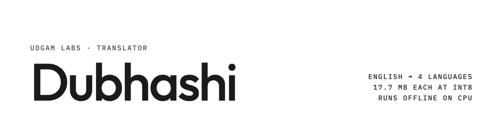

**UDGAM LABS** · Translator · English → Gujarati, Punjabi, Assamese, Odia · 17.7 MB each at int8

# Dubhashi

Dubhashi is four small translation models, one per direction: English → Gujarati, Punjabi, Assamese and Odia. Each has 17.3M
parameters and is 17.7 MB at int8, and runs offline on an ordinary CPU (about 30 ms a sentence on one core of a Mac
mini). They were distilled from IndicTrans2. English → Gujarati is ahead of Firefox's same-size offline model; the
other three are about 8.6 times smaller to download than indicMT, the smallest open alternative we found, and 1.5 to
4.8 chrF++ behind it.

[Model cards on Hugging Face](https://huggingface.co/udgamlabs/mt-draft-en-gu) · [Try it](https://huggingface.co/spaces/udgamlabs/mt-draft) · [udgamlabs.com](https://udgamlabs.com)

## Get started

```bash
pip install ctranslate2 sentencepiece huggingface_hub
python examples/translate.py gu "Can you send me the invoice for the last three months?"
echo "The train leaves at 6:45 tomorrow morning." | python examples/translate.py or
```

The first run downloads the 17.7 MB model for that language; after that it works offline. `gu`, `pa`, `as` and `or`
pick the language. In your own code, see the two quick starts (Transformers and CTranslate2) on each model card.

## Fine-tune it on your own sentences

```bash
pip install -r finetune/requirements.txt
python finetune/finetune.py --lang gu --train pairs.tsv --dev dev.tsv --out my-model --ct2
```

`pairs.tsv` holds one English sentence, a tab, and its translation per line. The output is a normal Transformers model
with a card whose header sets `base_model`, so a published copy links back; `--ct2` also writes the int8 build. Details
and settings: [`finetune/README.md`](finetune/README.md).

## How it works

Each model is a Marian encoder-decoder (6 encoder and 2 decoder layers, width 256, one shared 32,000-piece
SentencePiece vocabulary), trained from random weights on English sentences from IndicCorp v2 that IndicTrans2
dist-200M had translated. It translates one sentence at a time with greedy decoding; `examples/translate.py` splits
text into sentences first.

## Results

chrF++ (higher is better), our harness, the same sentences for every system; greedy for ours, beam 5 for indicMT
(153.8M, 169.2 MB at int8). Full tables with paired intervals are on each model card.

| Direction | Hugging Face | FLORES+ devtest | IN22-Conv | indicMT (FLORES+ / IN22-Conv) | Size at int8 |
|---|---|---:|---:|---:|---:|
| English → Gujarati | [`udgamlabs/mt-draft-en-gu`](https://huggingface.co/udgamlabs/mt-draft-en-gu) | 53.21 | 49.60 | 53.95 / 50.12 | 19.7 MB |
| English → Punjabi | [`udgamlabs/mt-draft-en-pa`](https://huggingface.co/udgamlabs/mt-draft-en-pa) | 49.41 | 51.47 | 51.89 / 54.72 | 19.5 MB |
| English → Assamese | [`udgamlabs/mt-draft-en-as`](https://huggingface.co/udgamlabs/mt-draft-en-as) | 39.90 | 42.57 | 41.42 / 44.70 | 19.7 MB |
| English → Odia | [`udgamlabs/mt-draft-en-or`](https://huggingface.co/udgamlabs/mt-draft-en-or) | 46.40 | 36.37 | 50.24 / 41.19 | 19.7 MB |

English → Gujarati against Firefox's same-size offline model (17.1 MB): +0.66 [+0.13, +1.20] on FLORES+ and +2.11
[+1.59, +2.67] on IN22-Conv (paired bootstrap, 95% interval). Firefox has no Punjabi, Assamese or Odia model.

## Where it falls short

- Behind indicMT and IndicTrans2 dist-200M on every set we scored (0.5 to 4.8 chrF++ behind indicMT).
- Some common letters are missing from each vocabulary and come out as "⁇" (Gujarati ઔ, ઐ, ઋ, ઑ; Assamese ঈ, ঊ, ঋ,
  ঐ, ঔ; Odia ଈ, ଊ, ଐ, ଔ; Punjabi writes 0-9 instead of Gurmukhi digits). 1 to 4% of test outputs carry one.
- Names are often mangled; idioms are translated word for word; long formal sentences lose meaning more often.
- English into these four only. No native-speaker review yet. Speed is measured on one Mac mini CPU, not on phones.

## Licence

Apache-2.0 for the code and the model weights. See `NOTICE` for IndicTrans2 (MIT) and IndicCorp v2 (CC0).

---

**About Udgam Labs.** Udgam Labs is an independent AI research lab. We work from first principles: before we build, we understand why things work, whether we are training a model, fine-tuning one or applying AI to a new problem. Udgam (उद्गम) is Sanskrit for origin. [udgamlabs.com](https://udgamlabs.com)
